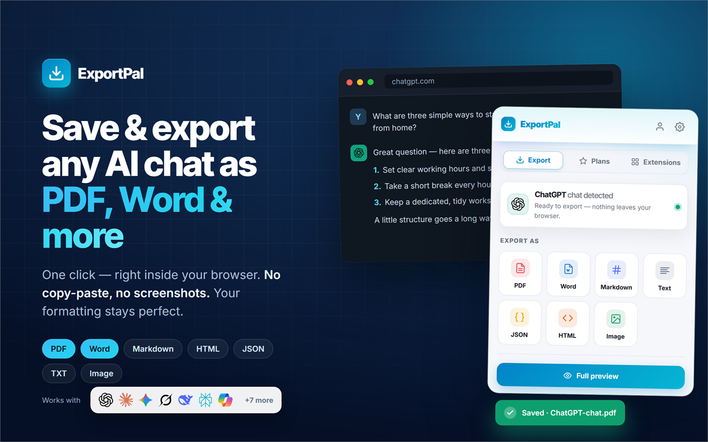
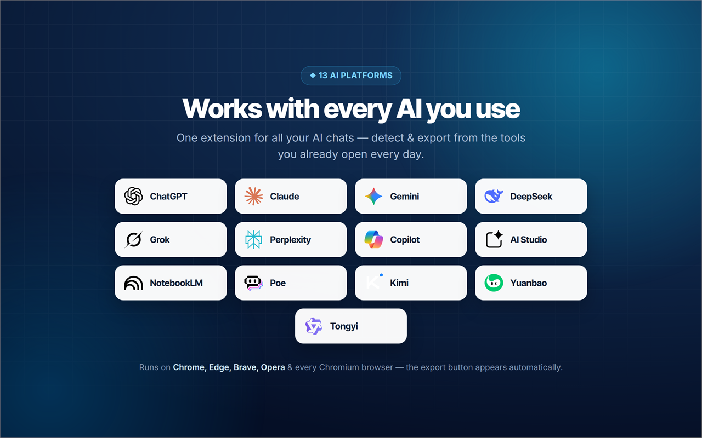
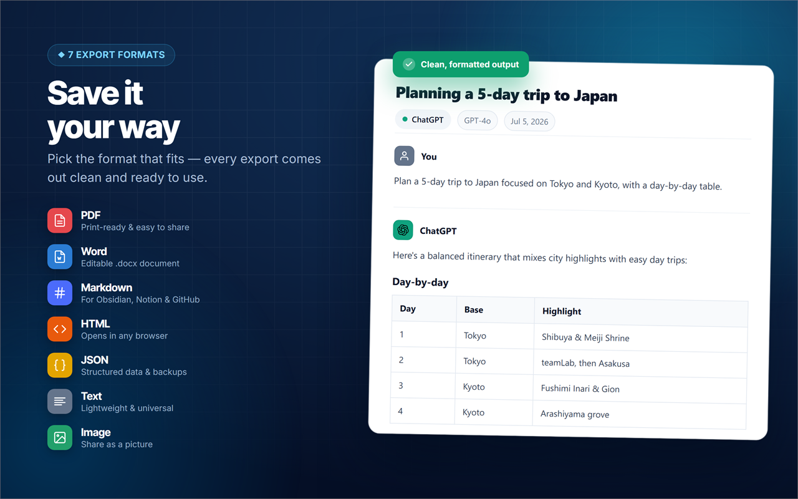

# ExportPal: Save and Export ChatGPT, Claude and Gemini Chats to PDF, Word and Markdown

ExportPal is a free Chrome extension that saves an AI conversation as a real file. It exports chats from ChatGPT, Claude, Gemini and other AI assistants (13 platforms in total) to PDF, Word, Markdown, HTML, TXT or JSON, and keeps the formatting: headings, tables and code blocks stay intact.

**[Install from the Chrome Web Store](https://chromewebstore.google.com/detail/lacjlchiogapkhimidaeaiadapdphjgd?utm_source=github&utm_medium=readme&utm_campaign=exportpal)** | **[Full guide and FAQ](https://www.addonschrome.com/extensions/exportpal-save-export-chatgpt-claude-gemini-to-pdf-word.html?utm_source=github&utm_medium=readme&utm_campaign=exportpal)**

This repository is the public home for ExportPal documentation, release notes and the issue tracker. The extension itself is distributed through the Chrome Web Store.

## Why not just print the page?

Printing a chat to PDF from the browser usually cuts long answers, breaks code blocks and drags the sidebar along. ExportPal reads the conversation itself and builds a clean document from it.

## Export formats

| Format | Good for |
| --- | --- |
| PDF | Sharing and archiving |
| Word (.docx) | Editing the text afterwards |
| Markdown | Notes apps, docs and Git repositories |
| HTML | A page that opens in any browser |
| TXT | Plain text |
| JSON | Developers and data processing |

## What is preserved

- Headings and lists
- Tables
- Code blocks

## How to use it

1. Install ExportPal from the [Chrome Web Store](https://chromewebstore.google.com/detail/lacjlchiogapkhimidaeaiadapdphjgd?utm_source=github&utm_medium=readme&utm_campaign=exportpal).
2. Open the conversation you want to keep in ChatGPT, Claude, Gemini or another supported assistant.
3. Open ExportPal and choose a format.
4. Download the file.

The [full guide](https://www.addonschrome.com/extensions/exportpal-save-export-chatgpt-claude-gemini-to-pdf-word.html?utm_source=github&utm_medium=readme&utm_campaign=exportpal) lists all 13 supported platforms.

## Pricing and privacy

ExportPal is free. The export is created on your device, in your browser.

## Screenshots

## Support and feedback

Found a bug or want a feature? [Open an issue](../../issues) in this repository. Please include your Chrome version and the steps that led to the problem.

## Disclaimer

ExportPal is an independent tool and is not affiliated with, endorsed by or sponsored by OpenAI, Anthropic or Google. ChatGPT, Claude and Gemini are trademarks of their respective owners.

---

Built and maintained by [Addons Chrome](https://www.addonschrome.com/?utm_source=github&utm_medium=readme&utm_campaign=exportpal).
